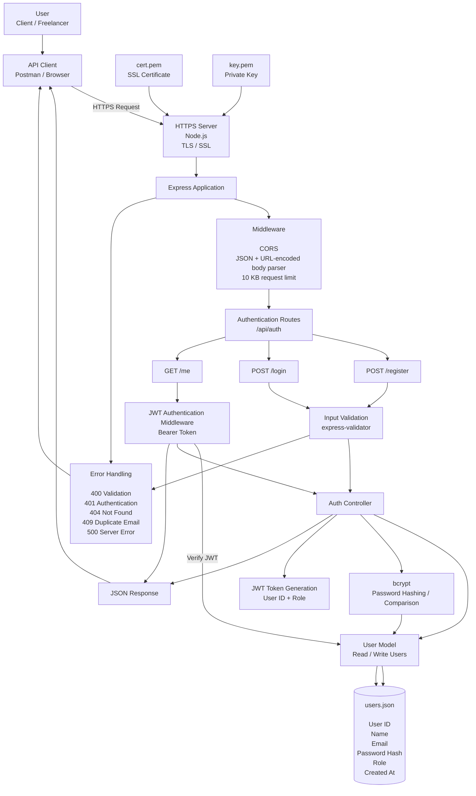

# HustleHub+ — Part 1

## 1. Project Overview

HustleHub+ is a digital platform designed to connect **clients and freelancers** in one central system. The purpose of the platform is to provide a secure environment where users can create accounts, authenticate themselves, and access services based on their roles.

The system aims to address the difficulty of managing interactions between clients and freelancers by providing a structured platform for user management and authentication.

The intended users of HustleHub+ are:

* **Clients** — users who require services from freelancers.
* **Freelancers** — users who provide services to clients.
* **Administrators** — users who will manage and oversee the platform as the system is expanded.

Part 1 focuses mainly on establishing the secure authentication foundation of HustleHub+. The implemented functionality includes user registration, user login, JWT-based authentication, protected user information, input validation, password hashing, HTTPS communication and error handling.


# 2. System Architecture

HustleHub+ is being developed using a **MERN-based architecture** as the overall technology direction of the project.

The MERN stack consists of:

* **MongoDB** — database technology planned for the later development of the system.
* **Express.js** — backend web framework.
* **React.js** — frontend technology planned for the user interface.
* **Node.js** — runtime environment for the backend.

### Part 1 Architecture

The current Part 1 implementation focuses on the **Node.js and Express backend/API**. The application currently uses a file-based storage approach with `users.json` rather than MongoDB.

The Part 1 architecture consists of:

**Client → HTTPS → Node.js/Express → Middleware → Authentication Routes → Controllers → User Model → users.json**

The application communicates using HTTPS. SSL/TLS certificates are stored in the `certs/` directory and are used by the Node.js HTTPS server.

### Data Storage

For Part 1, user information is stored in:

`backend/data/users.json`

This allows the authentication system to be developed and tested before the database layer is introduced.

In the planned later development of HustleHub+, the file-based storage approach can be replaced by **MongoDB**, allowing the application to move towards the full MERN architecture.

### Architecture Diagram



### Request Flow

When a user sends a request, it is first received by the HTTPS server. The request is then passed to the Express application and its middleware.

The middleware processes the request before it reaches the authentication routes. For registration and login, the input is validated before the request reaches the authentication controller.

The controller communicates with the User Model, which reads from or writes to `users.json`.

For successful registration or login, bcrypt is used to protect passwords and a JWT is generated. The server then returns a JSON response to the client.

Protected requests, such as `GET /api/auth/me`, pass through the JWT authentication middleware before the user's information is returned.


# 3. Project Structure

The important folders and files in the Part 1 repository are organised as follows:

```text
hustlehub-plus/
│
├── backend/
│   │
│   ├── certs/
│   │   ├── cert.pem
│   │   └── key.pem
│   │
│   ├── config/
│   │   └── config.js
│   │
│   ├── controllers/
│   │   └── authController.js
│   │
│   ├── data/
│   │   └── users.json
│   │
│   ├── middleware/
│   │   ├── authMiddleware.js
│   │   ├── errorHandler.js
│   │   └── validators.js
│   │
│   ├── models/
│   │   └── userModel.js
│   │
│   ├── routes/
│   │   └── authRoutes.js
│   │
│   ├── scripts/
│   │   └── generateCert.js
│   │
│   ├── utils/
│   │   └── generateToken.js
│   │
│   ├── .env
│   ├── .env.example
│   ├── package.json
│   └── server.js
│
└── postman/
    └── HustleHub_Part1.postman_collection.json
```

### Important Files and Folders

**`controllers/`**

Contains the authentication business logic. `authController.js` handles registration, login and retrieving the authenticated user's information.

**`middleware/`**

Contains middleware used to validate requests, authenticate JWTs and handle application errors.

**`models/`**

Contains `userModel.js`, which manages reading, creating and finding users in `users.json`.

**`data/`**

Contains the Part 1 file-based user storage.

**`routes/`**

Contains the authentication routes and connects API endpoints to the appropriate controller functions.

**`utils/`**

Contains utility functionality such as JWT token generation.

**`config/`**

Contains application configuration.

**`certs/`**

Contains the SSL/TLS certificate and private key used for local HTTPS communication.

**`scripts/`**

Contains the script used to generate the local SSL certificate.

**`postman/`**

Contains the Postman collection used to test the HustleHub+ API.

**`server.js`**

The main entry point of the backend application. It configures Express, middleware, routes, error handling and the HTTPS server.


# 4. Authentication & Security

## Registration

The registration process follows these steps:

```text
User Details
     ↓
Input Validation
     ↓
Duplicate Email Check
     ↓
bcrypt Password Hashing
     ↓
User Stored in users.json
     ↓
JWT Generated
     ↓
JSON Response
```

When a user registers, the application first validates the submitted information.

The registration validation checks the user's name, email, password and role.

The password must meet the required password rules. The password is then hashed using **bcrypt** before it is stored.

The original password is therefore not stored directly in `users.json`.

After the user has been successfully created, the system generates a JWT containing the user's ID and role. The token is returned to the client as part of the response.

---

## Login

The login process follows these steps:

```text
Email + Password
       ↓
Input Validation
       ↓
Find User
       ↓
bcrypt Password Comparison
       ↓
JWT Generation
       ↓
JSON Response
```

When a user logs in, the email and password are first validated.

The system searches for the user using the submitted email address. The submitted password is then compared with the stored bcrypt password hash.

If the credentials are correct, a JWT is generated and returned to the user.

If the credentials are incorrect, the application returns a `401 Unauthorized` response.

The application uses a general authentication error message instead of revealing whether an email address exists. This helps reduce the risk of account enumeration.

---

## JWT Authentication

**JSON Web Token (JWT)** is used to authenticate users after they have successfully logged in or registered.

The JWT contains the user's:

* User ID
* Role

Sensitive information such as the user's password is not placed inside the JWT.

The token allows the server to identify an authenticated user when they make requests to protected endpoints.

The token is sent with requests using the HTTP Authorization header:

```text
Authorization: Bearer <JWT>
```

The JWT authentication middleware verifies the token using the application's JWT secret.

The middleware then retrieves the corresponding user and attaches safe user information to the request.

The protected endpoint implemented in Part 1 is:

```text
GET /api/auth/me
```

If the JWT is missing, invalid or expired, the request is rejected with a `401 Unauthorized` response.

---

## Other Security Controls

### bcrypt Password Hashing

bcrypt is used to hash passwords before they are stored.

This is important because storing passwords in plain text would expose users' passwords if the storage file were compromised.

### Input Validation

The application uses `express-validator` to validate user input.

This helps prevent malformed or invalid information from being processed by the application.

Registration and login inputs are checked before reaching the authentication controller.

### HTTPS

The backend uses HTTPS with SSL/TLS certificates.

HTTPS encrypts communication between the API client and server, helping prevent sensitive information such as login credentials and authentication tokens from being transmitted in plain text.

### Error Handling

The application uses centralised error handling.

Errors such as invalid requests, authentication failures, missing routes and unexpected server errors are handled consistently.

The application avoids exposing unnecessary internal information or server stack traces to users.

### Environment Variables

Sensitive configuration values, including the JWT secret and other environment-specific settings, are stored using environment variables rather than being hard-coded into the application.

The `.env` file is used for local configuration, while `.env.example` provides an example of the required configuration.

This reduces the risk of accidentally exposing secrets in source code.

---

# 5. API Endpoints

The following endpoints are implemented in Part 1:

| Method | Endpoint             | Purpose                                     | Authentication |
| ------ | -------------------- | ------------------------------------------- | -------------- |
| POST   | `/api/auth/register` | Register a new user                         | Not required   |
| POST   | `/api/auth/login`    | Authenticate a user                         | Not required   |
| GET    | `/api/auth/me`       | Return the authenticated user's information | JWT required   |

### POST `/api/auth/register`

Creates a new client or freelancer account.

A successful registration creates the user, stores the password as a bcrypt hash and returns a JWT.

### POST `/api/auth/login`

Authenticates an existing user.

The submitted password is compared with the stored bcrypt password hash. If authentication succeeds, a JWT is returned.

### GET `/api/auth/me`

Returns information about the currently authenticated user.

This endpoint requires a valid JWT Bearer token.

---

# 6. API Testing

The HustleHub+ Part 1 API was tested using **Postman**.

The Postman collection is included in:

```text
postman/HustleHub_Part1.postman_collection.json
```

## Successful Tests

The following successful scenarios were tested:

| Test                                   | Expected Result |
| -------------------------------------- | --------------- |
| Successful registration                | `200 OK`        |
| Successful login                       | `200 OK`        |
| Protected `/me` request with valid JWT | `200 OK`        |

## Negative and Error Tests

The following error scenarios were also tested:

| Test                                | Expected Result    |
| ----------------------------------- | ------------------ |
| Duplicate email during registration | `409 Conflict`     |
| Invalid registration data           | `400 Bad Request`  |
| Incorrect password                  | `401 Unauthorized` |
| Unknown email                       | `401 Unauthorized` |
| `/me` without JWT                   | `401 Unauthorized` |
| Invalid JWT                         | `401 Unauthorized` |

These tests demonstrate that the API does not only handle successful requests but also responds appropriately to invalid input, authentication failures and protected-resource access attempts.

---

# 7. How to Run the Project

## Requirements

Before running the project, install:

* Node.js
* npm
* Postman for API testing

## Step 1: Clone or Extract the Project

Obtain the HustleHub+ project files and open the project directory in a terminal.

```bash
cd hustlehub-plus
```

## Step 2: Open the Backend

```bash
cd backend
```

## Step 3: Install Dependencies

Run:

```bash
npm install
```

This installs the dependencies required by the backend, including Express, bcrypt, JSON Web Token, express-validator, CORS and other packages.

## Step 4: Configure Environment Variables

Create a `.env` file in the `backend` directory using `.env.example` as a guide.

The environment configuration contains values required by the application, including the JWT secret and server configuration.

Sensitive values should not be committed to a public repository.

## Step 5: Check SSL Certificates

The HTTPS server requires the SSL certificate files:

```text
backend/certs/cert.pem
backend/certs/key.pem
```

If the certificates need to be regenerated, the certificate-generation script can be used.

## Step 6: Start the Server

Run the backend using:

```bash
npm start
```

For development, if the project configuration provides the development script, use:

```bash
npm run dev
```

The server runs as an HTTPS API.

## Step 7: Test the API

Open Postman and import:

```text
postman/HustleHub_Part1.postman_collection.json
```

The collection can then be used to test registration, login and the protected `/me` endpoint.


# 8. Evidence & Demonstration

A demonstration video of the HustleHub+ Part 1 application is available on YouTube.

**YouTube Video Link:**


